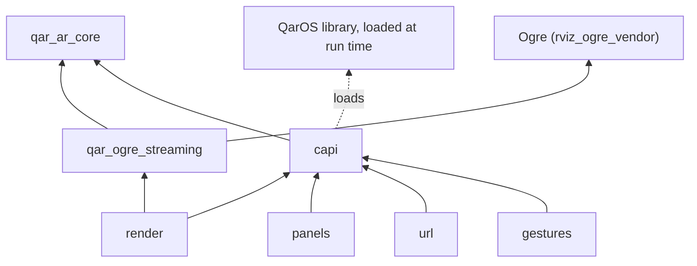
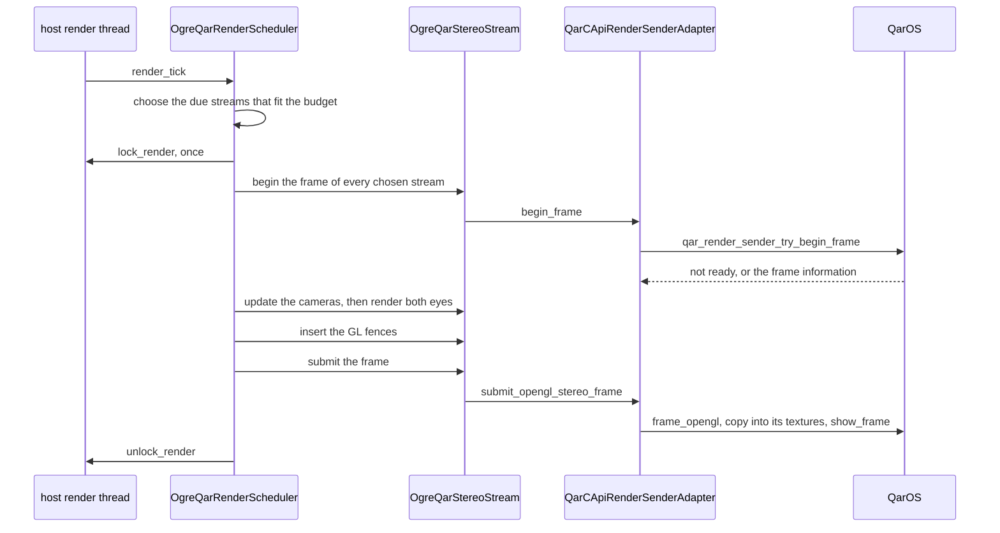

# Architecture

## Layers and components

The code is three modules of static libraries. `qar_ar_core` is the core that every other library builds on, `qar_ogre_streaming` renders an Ogre scene as stereo frames, and `qar_qar_adapter` is the only code that calls the QarOS C API, split into five components. Each arrow of the diagram is a link dependency. Nothing in this repository depends on Qt, ROS or RViz.

| Component | Target that a consumer links | What it holds | Main headers |
|---|---|---|---|
| `qar_ar_core` | `qar_ogre_adapter::qar_ar_core` | the types of the panel and pointer seams, the pointing ray, the spatial frames and the pick model, the timing log, and the one wrapper of the QarOS header | `panel_types.hpp`, `panel_input_source.hpp`, `pointing_ray.hpp`, `spatial_frames.hpp`, `spatial_pick.hpp`, `timing_log.hpp`, `qar_streaming_c.hpp` |
| `qar_ogre_streaming` | `qar_ogre_adapter::qar_ogre_streaming` | the stream manager, the batched render scheduler, the render budget, the eye render targets, the pose conversion, the scene lighting and the diagnostics | `ogre_qar_streaming_manager.hpp`, `ogre_qar_render_scheduler.hpp`, `render_budget.hpp`, `qar_pose_conversion.hpp`, `qar_scene_lighting.hpp`, `diagnostics.hpp`, `types.hpp` |
| `capi` | `qar_ogre_adapter::capi` | the program's one loader of the QarOS library, the arena of callback slots and the interface of the session owner; every other component links it | `qar_capi_session_owner.hpp`, `qar_capi_input_slots.hpp` |
| `render` | `qar_ogre_adapter::render` | the 3D stereo streams and the session bootstrap, `QarCApiSenderFactory` and `QarCApiRenderSenderAdapter`, with the geo anchor, the environment helpers and the stage timing; it is the only component that needs Ogre | `qar_capi_render_sender_adapter.hpp`, `geo_anchor.hpp`, `env_config.hpp`, `render_timing.hpp` |
| `panels` | `qar_ogre_adapter::panels` | the sender of a GUI panel that streams pixels, and the input of a panel | `qar_capi_panel_sender_adapter.hpp`, `qar_capi_panel_input_source.hpp` |
| `url` | `qar_ogre_adapter::url` | the GUI panel whose content is a URL | `qar_capi_url_panel_adapter.hpp` |
| `gestures` | `qar_ogre_adapter::gestures` | the gestures of an app volume | `qar_capi_spatial_gesture_source.hpp` |

A host links only the components that it needs: `panels`, `url` and `gestures` pull in neither Ogre nor Qt. [API](API.md#header-map) lists the headers of every module.

## The seams

A seam is an abstract interface that one module defines and another implements, so that the dependency points the right way and the code behind it can be replaced in a test. The first four rows are the interfaces through which code above the adapter sends content to QarOS or receives input from it; `IQarSessionOwner` serves the factories of the adapter, and the rest are supplied by the host.

| Seam | Defined in | Implemented by | What it separates |
|---|---|---|---|
| `IQarRenderSenderAdapter`, `IQarRenderSenderFactory` | `qar_ogre_streaming/qar_render_sender_adapter.hpp` | `QarCApiRenderSenderAdapter`, `QarCApiSenderFactory` (`render`); a recording test double in the tests | the Ogre library from the QarOS C API: one adapter for each peer, with `begin_frame` and `submit_opengl_stereo_frame` |
| `IQarPanelSenderAdapter`, `IQarPanelSenderFactory` | `qar_ar_core/qar_panel_sender.hpp` | `QarCApiPanelSenderAdapter`, `QarCApiPanelSenderFactory` (`panels`) | a library that streams pixels into a GUI panel from the QarOS C API |
| `IQarUrlPanelAdapter`, `IQarUrlPanelFactory` | `qar_ar_core/qar_url_panel.hpp` | `QarCApiUrlPanelAdapter`, `QarCApiUrlPanelFactory` (`url`) | a library that serves a page from the call that opens a GUI panel on its URL |
| `IQarPanelInputSource` | `qar_ar_core/panel_input_source.hpp` | `QarCApiPanelInputSource` (`panels`), `QarCApiSpatialGestureSource` (`gestures`), `QueuedPanelInputSource` | the consumers of pointer samples from the origin of the samples; the queue is the thread-safe source for tests and simulators |
| `IQarSessionOwner` | `qar_qar_adapter/qar_capi_session_owner.hpp` | `QarCApiSenderFactory`; a host that opens its own session | the factories of the panels from the code that owns the QarOS session |
| `IRenderThreadExecutor` | `qar_ogre_streaming/render_thread_executor.hpp` | the host | the library from the thread model of the host: it asks `is_render_thread()` and the scheduler refuses to render elsewhere |
| `IRenderLock` | `qar_ogre_streaming/render_lock.hpp` | the host, optional | the one lock that the host holds around Ogre and GL work; none means no locking |
| `IClock` | `qar_ogre_streaming/clock.hpp` | `SteadyClock` by default; a fake clock in the tests | the pacing logic from the wall clock |
| `IGlFenceHook` | `qar_ogre_streaming/gl_fence_hook.hpp` | `GlFenceHook` in `ogre_opengl_texture_bridge.hpp`, optional | the step of the batch that inserts a GL fence; no hook means no step |
| `IQarGlTextureCopyHook` | `qar_qar_adapter/qar_capi_render_sender_adapter.hpp` | the blit of `make_gl_copy_image_hook()` | the adapter from GL: the copy of the Ogre textures into the textures of QarOS |
| `OgreQarDiagnosticsSink`, `PanelDiagnosticsSink` | `qar_ogre_streaming/diagnostics.hpp`, `qar_ar_core/panel_types.hpp` | the host | the libraries from the logging of the host; a sink must not block |

[API](API.md) shows how a host wires these seams.

## 3D stream data flow

The host calls `OgreQarStreamingManager::render_tick()` on its render thread. One call renders, in one batch, the streams that are due and that the render budget admits:

- **One batch, one lock.** The scheduler chooses the streams that are due under the render budget, takes the render lock once, begins the frames of all chosen streams, updates all cameras, places the per-peer lights, renders all targets, inserts the fences and submits all frames, and only then releases the lock. Every peer therefore samples the same snapshot of the scene. A tick in which nothing is due takes no lock.
- **The begin-frame wait never blocks.** The adapter polls `qar_render_sender_try_begin_frame`. While QarOS has not asked for a frame the adapter answers that no frame is wanted this tick, and the stream records the skip as *sender not ready* with the detail `begin-frame pending (no render request from the viewer)`. A failing call is the other kind of skip, *sender error*.
- **Eye render targets are made on first use.** The first frame of a stream creates its two eye targets, a colour texture and a depth texture for each eye, inside the batch and therefore on the render thread with the lock held. Both eyes are rendered with `update(false)`, which renders into the texture without presenting anything.
- **The view comes from QarOS.** For every frame the adapter reads the pose and the field of view of the views 0 and 1 of the frame information and pairs them with the near and far distances of its configuration; the stream converts them into the camera placement and the off-axis projection of each eye ([Pose, projection and world basis](#pose-projection-and-world-basis)). When one of these four reads fails, the adapter releases the frame without rendering it, and the stream records *sender error* with the failed call and its status in the detail.
- **Submitting copies into the textures of QarOS.** The adapter asks QarOS for the destination textures of the frame with `qar_render_sender_frame_opengl`, has the copy hook blit the rendered colour and depth textures into them, waits with `glFinish` until the copy is complete, and shows the frame. It then starts the wait for the next frame, so that the wait runs in the gap between two ticks and a frame costs one tick.
- **The end of a stream.** When QarOS reports the stream of a peer closed, the adapter sets a flag and `QarCApiSenderFactory::poll_closed_peers` lists the peer; the host destroys the stream.

Why QarOS owns the textures and why the copy is a blit are in [Render-into and the GL context](QAROS_INTEGRATION_NOTES.md#render-into-and-the-gl-context).

## Session bootstrap and peers

`QarCApiSenderFactory` runs the whole bootstrap in its constructor and blocks until it is done, so a host with a window constructs it on a worker thread. A failure is not thrown: `ready()` tells whether the bootstrap worked and `last_error()` says what failed. The constructor makes these calls, in this order; [Session bootstrap](QAROS_INTEGRATION_NOTES.md#session-bootstrap) says why each is there.

1. `qar_library_load` for `<runtime_binaries_folder_path>/qar-streaming-c.dll`, or for `Config::sdk_library_path`, unless the library is already loaded.
2. `qar_library_init` with the folder, the severity and the console setting of the log. Before it, the factory exports the severity as `QAR_LOG_SEVERITY`, and it starts the logger of the transport when `QAR_ZENOH_LOG` asks for it and the severity is trace or debug.
3. `qar_runtime_create` with the runtime binaries folder.
4. `qar_runtime_create_session` with a unique session id and the launcher configuration, then `qar_session_invite_serialize` and `qar_session_join` on that invite, which yield the session.
5. `qar_session_get_my_spec`, to learn the own peer id, which no admission policy ever admits.
6. `qar_app_volumes_add_volume`, which creates the one app volume that every stream is keyed to. A failure is not fatal for the connection, but no stream can be created without the volume.
7. `qar_peer_subscribe_updates`, so that peers that join are reported to the factory.
8. `qar_session_invite_peer` for the Visualizers of `Config::auto_invite_visualizers`, none by default, and for the devices named in `Config::invite_peers`, in the form `kind[:hostname]` separated by commas.

Then `ready()` is true, and the settle window of the admission policy `kInvitedOrNew` starts, 5 s by default.

From then on the host runs a loop on its render thread:

- `capture_gl_context()` latches the OpenGL context that is current on the thread, because a sender can be created only once a context is known;
- `poll_new_peer_requests()` lists the peers that the policy has admitted, and the host calls `create_stream` for each; the factory then creates the sender of that peer, asynchronously: the first calls return no sender, and `qar_render_sender_create_async` delivers the result on a QarOS thread. The host asks again with `on_render_request` until the sender exists, and the factory logs once that a creation is still pending after 5 seconds.
- `poll_closed_peers()` lists the peers whose stream QarOS closed. It does not consume them, so the host calls `forget` for each, which also frees the place of the peer under the limit on concurrent peers.

A peer gets a stream only if the admission policy admits it. The default policy, `kInvitedOnly`, admits only the peers that the factory invited itself, never more than `Config::max_peers`, 8 by default. With `Config::invite_flow_admission` off every peer except the own one is admitted. [Peers, invites and admission](QAROS_INTEGRATION_NOTES.md#peers-invites-and-admission) describes the other policies and why they exist.

A host that opens its own session does not use this factory: it implements `IQarSessionOwner` over its session, and the factories of `panels` and `url` borrow that ([Component capi](API.md#component-capi)).

## GUI panels, URL panels and input

A GUI panel reaches QarOS by one of two routes. The component `panels` streams pixels, which a library of the stack captures from a widget. The component `url` opens a panel on a URL that a program serves, and QarOS renders the page itself.

**The streaming route.** `QarCApiPanelSenderFactory` borrows the session of an `IQarSessionOwner` and makes one `QarCApiPanelSenderAdapter` for each panel. The adapter builds the panel in three calls and fails the creation when one of them fails:

1. `qar_video_sender_create` makes a CPU video sender whose layout is one texture and one colour view without an eye, with the size of the buffer that the host captures;
2. `qar_video_sender_stream_id` reads the identity of its stream;
3. `qar_gui_panels_add_panel` makes the panel, with a `QarGuiPanelStreamIdExt` that names the stream. Without that extension QarOS would make a website panel.

Each tick of the host is `try_begin_frame` and, when it reports a free destination, `submit_frame`, which copies the rows of the buffer into the frame of QarOS and shows it. A sender that nothing has attached to yet answers the status 604 (no active transfer), and one whose receiver is reconnecting answers 603; the adapter reports both as "not ready", not as failures. The size of the buffer is fixed for the life of a sender, so a resized widget needs a new adapter.

**The input of a panel.** If the factory was given a `QarCApiPanelInputSource`, every adapter subscribes its panel through it as soon as the panel exists. The source makes two subscriptions for a panel: one `qar_gui_panels_subscribe_all_gesture_events` reader for every kind of gesture, so that a hover and the drag that grows out of it keep their order, and one `qar_gui_panels_subscribe_panel_updates` subscription, which tells the source that the operator closed the panel in AR. A failed subscription is not fatal: the panel streams and takes no input.

The callback of QarOS reads everything from the gesture handle at its top, because the handle is valid only for the duration of the call, converts the content pixel into a position `(u, v)` on the panel, and pushes a `PanelPointerSample` into a queue. It touches nothing else. The host drains the queue on its GUI thread with `drain()`. The conversion adds half a pixel, divides by the content size that the adapter was given, flips no axis and applies no `content_scale`, and clamps a position outside the content to its edge. Each hand of each peer is a pointer of its own: the pointer id is a hash of the peer id and the hand. A lifecycle that stays silent for 0.75 s, three of the 250 ms heartbeats of QarOS, is cancelled by the source, which recovers a producer that died in the middle of a drag.

**Closing a panel.** `close(panel_closed_in_ar)` cancels the input subscriptions first, then closes the GUI panel unless the operator already did, and destroys the video sender last, whatever the second step did. A second call does nothing. [Ownership and teardown](#ownership-and-teardown) gives the reasons.

**The URL route.** `QarCApiUrlPanelFactory` makes a `QarCApiUrlPanelAdapter`, which adds a panel with a `QarGuiPanelUrlExt` that carries the URL and can then navigate it, move and resize it, show, minimise or hide it, and close it. There is no video sender and no frame loop, and the adapter subscribes to no gestures: the page handles pointer input itself and reports it over its own connection.

**Callbacks only enqueue.** All QarOS callbacks of this repository follow one rule: convert, queue and return, without blocking and without calling a subscribe function. The state that a callback may reach lives in a slot of a process-lifetime arena in `capi`. A slot is never freed or reused. Retiring a subscription cancels its token, disowns the slot under the mutex of the slot, and only then destroys the token handle; once that returns, no callback is inside the owner and none ever will be again. One subscription is the exception: the subscription to peer updates of `QarCApiSenderFactory` passes the factory itself as the state of its callback, with no cancel token and no slot. What keeps that callback from reaching a freed factory is the destruction of the session and then of the library in the destructor of the factory. The header does not say whether a callback that is running has returned when those calls return, so this stack assumes it.

## Spatial gestures and the pointing ray

A person who points at the scene produces gestures against the app volume, and this repository turns them into picks in the ROS world. The path has four parts.

**The subscription.** `QarCApiSpatialGestureSource` subscribes once to the volume that the factory created, with `qar_app_volumes_subscribe_all_gesture_events`, and dispatches on the kind of each gesture. If that call fails it falls back to one subscription for clicks and one for hovers. Only clicks and hovers become pointer samples; the three manipulation kinds move or scale the volume themselves, so the source only counts them. The volume is created without a gesture configuration, so that the runtime applies its default rules.

**The sample.** A sample carries the start point of the gesture, which is the hand, and its action point, which is what the aim intersected or the start point again when nothing was intersected; both are in app content space. When the two points are equal the sample says that its point is not a scene hit.

**The ray.** The line from the start point to the action point is the ray that the runtime reports, and it is the preferred one; equal points are the documented no-intersection case, and the only one in which that function refuses a ray. For that case the repository keeps a fallback, a straight line from the eye through the index fingertip, or through the palm when the fingertip is not tracked, with the right hand preferred and the other hand used when the right one is not tracked. The render thread builds it: once per ready frame, right after it read the eye pose of the frame, the adapter polls the hands with `qar_render_sender_last_hands` and publishes the ray, together with the joints it came from, into a `PointingRaySlot`, and the gesture callback reads the latest value from there. An eye closer than 15 cm to the hand gives no ray, because the direction is then noise.

**The pick.** `spatial_pointer_from_sample` brings a sample across the change of axes into the ROS world, and a sample that holds only a position on a panel is not a spatial pick. Each kind of pick is an explicit state machine that the pointer phase drives and that can be cancelled without publishing: `PointPickSession` previews the point under the pointer and commits it on release, `PosePickSession` adds a heading from the direction of a drag, and `AreaPickSession` sweeps a rectangle, a circle or a polygon; `make_nav_goal` shapes a pose for a navigation stack. Only a click commits; a hover only moves a preview.

What a pick is resolved against is a `PickTarget`. A `PickTarget` is the ground plane unless you choose another target; the target that publishes the point of the runtime unchanged is `PickTarget::action_point()`.

| Target | With a ray | Without a ray |
|---|---|---|
| ground plane, plane | the intersection of our straight ray with the plane | the reported point, projected onto the plane |
| fixed depth | the distance along our straight ray | the reported point |
| action point | the reported point, which wins over any ray | the reported point; refused when nothing was intersected |

Our straight ray is an approximation of the slightly curved ray that the runtime casts, so a plane or depth target lands near the answer of the runtime and not on it; [The pointing ray](QAROS_INTEGRATION_NOTES.md#the-pointing-ray) and the design notes below give the reasons.

## Threading model

All Ogre and OpenGL work happens on one thread, the render thread of the host, and a host with a render lock holds it while the batch runs. The library learns which thread that is only through `IRenderThreadExecutor`.

| Thread | What runs there | Rule |
|---|---|---|
| render thread of the host | `render_tick`, the creation of eye targets, `capture_gl_context`, `create_sender`, `begin_frame` and `submit_opengl_stereo_frame`, the polling of the hands, `poll_new_peer_requests` and `poll_closed_peers` | the only thread that touches Ogre and GL; the scheduler refuses to run elsewhere |
| graphics thread of QarOS | reads the textures of a sender, with the WGL context that the factory created for that sender | the factory only supplies the context and its four callbacks; it never makes the context current on the render thread |
| callback threads of QarOS | the peer updates, the gestures of panels and of the app volume, the result of the asynchronous sender creation | convert, queue and return; they never block and never subscribe |
| GUI thread of the host | the panel and URL panel adapters, the subscribe and unsubscribe calls, `drain` of the input sources | the adapters are not thread-safe and are called from one thread |
| worker thread of the host, optional | the construction of `QarCApiSenderFactory`, which blocks for seconds | the host decides; the factory is not usable before `ready()` |
| writer of the timing log | the formatting and writing of the CSV files | started only when the timing folder is set; hooks only append numbers to an in-memory buffer |

Three details are worth knowing. The factory is shared between threads under one mutex that guards the peer queues, the invited and admitted lists and the adapter list, because the callback threads and the render thread both touch them. The pointing ray crosses from the render thread to the gesture thread through a one-value slot: the last writer wins and a reader gets a copy, so a reader never blocks a frame. And the sender is created asynchronously exactly so that the render thread never waits for it: a creation could take arbitrarily long with an SDK drop earlier than that of 2026-09-28, and a call that waited would stop every other stream.

## Ownership and teardown

| Object | Owned by | Notes |
|---|---|---|
| `Ogre::Root`, the scene manager | the host | the library holds a pointer to the scene manager and never creates or destroys it |
| the eye cameras and render textures of a peer | `OgreQarStereoStream`, through `OgreStereoRenderTarget` | created on the first frame, destroyed with the stream |
| the lights of the lighting rig | `QarSceneLighting` | strictly additive; `shutdown()` restores the ambient colour and the visibility of the light that it hid |
| the QarOS library, the runtime, the invite, the session | `QarCApiSenderFactory` | the factory loads the library only if it is not loaded yet and unloads it only if it loaded it |
| the app volume | the session, created by the factory | every render sender names it |
| a render sender | `QarCApiRenderSenderAdapter` | created by the factory and shared with its stream; the factory keeps a weak reference per peer |
| a GL context for QarOS | `QarCApiSenderFactory` | one for each sender, shared with the Ogre context, never current on the render thread; deleted after the library is destroyed |
| the GL fence of a stream | `OgreQarStereoStream` | at most one is outstanding; a new one replaces and deletes the old one |
| a panel sender and its GUI panel | `QarCApiPanelSenderAdapter` | closed by `close`, in the order below |
| the callback slots | the arena in `capi` | never freed and never reused |
| a URL panel | `QarCApiUrlPanelAdapter` | closed by `close` or by the destructor |

The session is the owner that the panel factories borrow, so the factory of the session must outlive every adapter, sender and subscription. The destroy order that the code follows is:

1. **Streams first.** The host destroys the manager, and with it every stream and its sender. A stream first releases a frame handle that was fetched and not used, and then destroys the sender.
2. **A panel in three steps.** Cancel the input subscriptions of the panel, close the GUI panel unless the operator already closed it in AR, and destroy the video sender whatever the second step did. Cancelling first matters because the runtime republishes a panel that is being closed as closed, and with the subscription still live that echo would look like the operator closing it; the sender goes last because the panel is its consumer.
3. **A subscription** is retired by cancelling its token, so that QarOS stops delivering, then giving up its callback slot, so that a callback that is already running finds nothing to touch, and only then destroying the token handle.
4. **The factory last.** Its destructor destroys the session, then the invite handle, then the runtime, and then, when the library is loaded, calls `qar_library_destroy`; the GL contexts of the senders are deleted only after that, so that no context is deleted while a thread of QarOS may still have it current, and the library is unloaded at the very end.

The header documents no order of teardown, so this order is a choice of this repository, and what the runtime does with a stream that is destroyed while a receiver is attached is a [known limitation](QAROS_INTEGRATION_NOTES.md#known-sdk-limitations).

## Render scheduling and budget

Every peer costs four scene renders per frame, a colour render and a depth render for each of its two eyes, so the scheduler decides on every tick which streams render. The decision, made by `RenderBudget`, is pure arithmetic over the time that the scheduler reads once per tick from its `IClock`, so that it is tested with a fake clock.

| Setting | Where | Default | Meaning |
|---|---|---|---|
| `StereoStreamConfig::max_fps` | one for each stream | 72 | the target rate of the stream; 0 would mean render on every tick, but the configuration refuses 0 |
| `RenderBudgetConfig::max_batch_milliseconds` | the manager | 16.0 | the soft budget of one batch for all peers; 0 means unlimited |
| `RenderBudgetConfig::max_streams_per_tick` | the manager | 0 | a cap on the streams rendered in one tick, which streams under floor protection exceed; 0 means unlimited |
| `RenderBudgetConfig::floor_fps` | the manager | 30 | a due stream that has not rendered within 1/30 s is always admitted; 0 switches the protection off |
| `RenderBudgetConfig::default_stream_cost_ms` | the manager | 2.0 | the cost assumed for a stream that has never rendered; the measured cost replaces it after the first render |
| `QarCApiSenderFactory::Config::max_peers` | the factory | 8 | the ceiling on concurrently streamed peers |

A stream is due when the time has reached its *next due* time. Rendering advances that time by one frame interval, but never to a time earlier than now, so the rate is right on average even when the tick rate is not a multiple of the frame interval, and a stream that stalled does not burst to catch up. The due streams are ordered most overdue first, then by the order in which they appeared, and the scheduler admits them in two passes: a stream under floor protection is admitted unconditionally, and the others are admitted while the sum of the estimated costs stays within the batch budget and the cap. A due stream that does not fit is shed for this tick and counted as a skipped frame with the reason *budget shed*. Its due time does not advance, so it is still due on the next tick, when the same two passes decide again and can shed it again.

The scheduler keeps a rolling window of the last 120 batches and 120 submit times of each stream, from which it derives the mean batch time and the achieved frame rate in the [diagnostics](#diagnostics).

## Pose, projection and world basis

QarOS describes a view with a pose and a field of view, and the stream turns both into an Ogre camera. The conversion is in `qar_pose_conversion.hpp`.

**The camera-local frames agree.** QarOS follows the OpenXR convention, right-handed with +Y up and -Z forward, and so does an Ogre camera. A position therefore copies unchanged, and an orientation copies component for component: only the storage order changes, from x, y, z, w to w, x, y, z, and the quaternion is normalised. `qar_pose_to_ogre` refuses a quaternion of near-zero length with `InvalidArgument`; the convenience form `qar_orientation_to_ogre` returns the identity instead.

**The projection is off-axis.** Each eye has its own signed half-angles, so `make_projection_from_qar_fov` builds the asymmetric perspective matrix of the classic OpenGL frustum from them: row-major, clip depth from -1 to +1, which is what `setCustomProjectionMatrix` takes. It refuses a field of view that cannot form a frustum: a near distance that is not positive, a far distance that is not beyond the near one, a right angle that is not greater than the left, an upper angle that is not greater than the lower, or any angle at or beyond a right angle. A degenerate pose or field of view leaves the previous state of that camera, so one bad frame never blanks a view.

**The world frames do not agree.** QarOS hands out poses in a Y-up world, while a ROS scene, such as the one of RViz, is Z-up with +X forward (REP 103). A Y-up pose fed into a Z-up world tips the viewer on its side. By default the library maps the worlds one to one, which is right for Y-up content. With `QAR_POSE_WORLD=zup` it rotates the QarOS world into the ROS world with ros = (-z, -x, y), the quaternion (w, x, y, z) = (0.5, 0.5, -0.5, -0.5): QarOS up becomes ROS up and QarOS forward becomes ROS forward. Only the exact value `zup` switches it on. A viewer anchor follows the change of axes and only in this mode: a yaw about the ROS +Z axis, 180 degrees by default (`QAR_POSE_YAW_DEG`), an eye height along +Z (`QAR_POSE_HEIGHT_M`) and a stand-off behind the facing direction (`QAR_POSE_BACK_M`), both 0 by default. The two translations default to zero on purpose: QarOS reports the viewer in its own frame, and a translation that is applied only on this side would be invisible to QarOS, so the two worlds would disagree about where the viewer stands. The variables are read once for each process.

**A pick uses the same map as the camera.** What the wearer aims at is what the camera showed, so `spatial_frames.hpp` reproduces the same transformation, including the anchor, and reads the same variables; `room_to_ros_from_environment` reads them in one place. The placement of the app volume stays out of that transformation: view poses, hand poses and gesture points are already in app content space, so they need the change of axes and nothing else. [Gesture points are in app content space](#gesture-points-are-in-app-content-space) gives the reason.

## Depth encoding

The GL3+ render system of Ogre 1.12 cannot expose a metric, sampleable hardware depth texture through its public API, so the library writes depth as colour: a single-channel 32-bit float texture, rendered by a second pass of the scene through the material scheme `qar_linear_depth`, whose shaders replace the material of every object. The produced and transmitted format is therefore always `QAR_PIXEL_FORMAT_R32_FLOAT`, whatever depth format the stream configuration asks for.

The texture holds one of two encodings, chosen by `QAR_DEPTH_ENCODING`:

| Encoding | Value written | Where nothing was drawn | Chosen by |
|---|---|---|---|
| metric, the default | the linear eye-space distance in metres, optionally multiplied by `QAR_DEPTH_SHADER_SCALE` | 0 | `QAR_DEPTH_ENCODING` unset or any value other than `ndc` |
| window space | `gl_FragCoord.z`, the value of an OpenGL depth buffer in the range 0 to 1, derived from the same projection that the camera renders with | 1, the far plane | `QAR_DEPTH_ENCODING=ndc` |

The scale applies to the metric encoding only, must be greater than 0, and a malformed value keeps metres. Both variables are read once for each process, when the first depth target is created.

The encoding matters because the QarOS Visualizer reads the depth texture as the raw window-space value and inverts it with the near and far distances. Metric data then shows as nothing up close and as one saturated colour for the rest, and neither `depth_scale` nor `rendered_near_far` changes that, so set `ndc` for the Visualizer. The SDK does not document what any other peer does with the depth values. [Depth encoding](QAROS_INTEGRATION_NOTES.md#depth-encoding) has the details.

Two properties of the window-space value follow from its curve. It is reciprocal in distance, so a far plane that is much wider than the content leaves little of the range for the near surfaces. And everything beyond the far plane is clipped away. The far distance is `Config::near_far` of the factory, 500 m by default, and the adapter reports it, with the near distance and the `depth_scale` of 1.0, with every frame it shows.

## Scene lighting

A host such as RViz lights its scene for one operator: it keeps a single directional light, `MainDirectional`, aimed along the direction of the view of the local operator, a headlight that follows whoever drives the 3D view. For a remote peer that is the wrong light, because the shading of the scene then pivots whenever the operator orbits their own camera. Adding lights alone only softens the effect.

`QarSceneLighting` is an optional rig, passed in `OgreQarStreamingConfig::scene_lighting`, that the manager applies while streaming is active and removes when it stops. It has four modes, `SceneLightingMode`, which `parse_scene_lighting_mode` reads from the words `off`, `omni`, `per-peer` and `both`:

| Mode | What it adds |
|---|---|
| `kOff` | nothing; the host's lighting stays untouched |
| `kOmni`, the default of the configuration | a raised ambient colour and four directional lights on a tetrahedron, so that every surface normal faces at least one light and nothing is unlit; directional lights do not depend on position, so the world is lit evenly however far a peer stands from the origin |
| `kPerPeer` | one point light for each peer, moved to the head of that peer on every tick |
| `kOmniAndPerPeer` | both |

The two directions that arrive from above carry the key light, and the two from below are scaled by `fill_ratio`, 0.55 by default, so that undersides are lit without the scene looking floodlit from the floor. The default ambient colour is 0.30 on every channel, the key diffuse colour 0.75, and a light has no distance falloff unless `attenuation_range` is set.

Hiding the headlight is a separate, optional step: `suppress_light_name` names a light of the host scene, `MainDirectional` in RViz, that the rig hides while it is applied. The rig saves the ambient colour and the visibility of that light and restores both in `shutdown()`, which the destructor and the manager also call, and it names everything that it creates with the prefix `qar/scene_light/`, so that it can never remove a light of the host. Every call of the rig touches Ogre and runs on the render thread; the scheduler places the per-peer lights after all cameras are placed and before any eye renders, so that no frame is lit by the stale light of another peer.

## Geo anchor

An app volume can be pinned to the Earth, and the factory offers three calls for it. `set_geo_anchor_wgs84(latitude, longitude, altitude)` takes a geodetic fix, `set_geo_anchor_ecef(origin, axis_x, axis_y, axis_z)` takes a frame that is already in ECEF, and `clear_geo_anchor()` removes the anchor; `has_geo_anchor()` tells whether one is set. All three need the volume that the factory created, and the setters return an empty string on success and a reason otherwise.

The arithmetic is separate from the session so that it can be tested: `geodetic_to_ecef_enu` in `geo_anchor.hpp` converts latitude, longitude and the height above the WGS84 ellipsoid to the ECEF origin and to the east, north and up axes at that point, and the factory takes those axes as the +X, +Y and +Z axes of the anchor, which is the ROS convention (REP 103). The height is the ellipsoidal height that the ROS message `NavSatFix` carries, not the height above mean sea level, and the two differ by tens of metres.

The conversion refuses a fix that is NaN, infinite or out of range, and the factory then does not touch the anchor. The NaN test comes first on purpose: a receiver without a lock reports NaN, which compares false against every bound, so a bare range check would let it through. `geo_fix_moved` tells whether two fixes are far enough apart, by a threshold that the caller passes, to be worth another call; it measures the east-west distance with the metres of a degree of latitude, which over-estimates it and so errs towards re-anchoring, and it treats an unusable fix as moved. Unit tests check that the east, north and up basis is right-handed and that a NaN fix is rejected.

## Diagnostics

**Skip reasons.** A tick that produced no frame for a stream names its reason, because a bare counter cannot tell a viewer that does not ask for frames from an adapter that fails.

| `SkipReason` | Meaning |
|---|---|
| `SenderNotReady` | the adapter has no frame this tick because the begin-frame wait is still pending; the benign steady state, in which the viewer paces the stream below the tick rate |
| `SenderError` | `begin_frame` failed: an SDK error, or the producer is closed |
| `TargetInitFailed` | the creation of the eye targets failed inside the batch |
| `BudgetShed` | the render budget dropped a frame that was due |

The totals of the four reasons always add up to `frames_skipped`, and `last_skip_detail` carries the account of the adapter for the latest skip. A stall therefore shows as `SenderNotReady` for ever while the submit counter stays frozen; an adapter that fails shows as `SenderError`.

**The snapshot.** `OgreQarStreamingManager::diagnostics_snapshot()` returns a copyable `DiagnosticsSnapshot`: whether streaming is active, the batch counters and the mean batch time, the streams served and shed in the last batch, the frames shed by the budget, the last error, and one `StreamDiagnostics` for each stream, with its submitted and skipped frames, the per-reason totals, the render time of each eye and the achieved frame rate, which the scheduler derives from its submit times. The host reads it on the render thread.

**The per-frame trace.** With `QAR_ADAPTER_FRAME_TRACE` set to any value, each render sender writes one CSV file, `qar_frame_trace_<date and time>_<peer>.csv`, into the log folder of the factory, or into the folder `quaternar` of your `TEMP` folder when it has none. A row describes one submitted frame: when its begin-frame wait started and became ready, when its pose was consumed, when the render and `qar_render_sender_show_frame` finished, the pose that was rendered, and how far the pose differs when the same frame handle is read again just before `qar_render_sender_show_frame`.

**The stage timing.** With `QAR_VIDEO_TIMING_DIR` set to a folder, the adapter writes the stages of the 3D stream into `render3d.csv`, `render3d_2.csv` for the second stream, and so on. A row is one of four kinds: a run of not-ready answers, a ready answer, a submit, or a begin-frame call that took more than 2 ms. All times are microseconds since the Unix epoch on the system clock, the one clock that processes share. A single writer thread formats and writes the files about once a second; the hooks only append numbers to a buffer in memory, which holds at most 65,536 rows for each file, and an extra row is counted as dropped, so that no disk can stall the render thread.

**The log lines.** The adapter prints its own state to the standard error stream with the prefix `[qar-adapter]`, the panel adapter with `[qar-panel-adapter]`, the URL panel adapter with `[qar-url-panel-adapter]`, the panel input with `[qar-panel-input]`, the app-volume gestures with `[qar-spatial]` and the timing log with `[qar-timing]`. With `QAR_ADAPTER_TRACE` set, the bootstrap prints a flushed line with the elapsed time before and after each main SDK call, so that the last line names the call that hangs or faults; the frames are traced for the first 150 and then one in 300, unless `QAR_ADAPTER_TRACE_ALL` is set. [Reading the logs](TROUBLESHOOTING.md#reading-the-logs) says what the lines mean.

## Background: Ogre 1.12 for QarOS engineers

This section explains the parts of Ogre that the library uses, for a reader who knows the QarOS C API but has not worked with Ogre. The version is 1.12.1, from the ROS 2 distribution (see [Ogre build notes](DEVELOPING.md#ogre-build-notes)).

- **Root, render system, scene manager.** `Ogre::Root` is the entry point of the engine: it owns the render system, which issues the GPU commands and owns the GL context, and the resource managers. A scene manager owns the scene graph, the tree of nodes with the entities, lights and cameras attached to them. The host creates and owns all of them; the library gets only a pointer to the scene manager. It creates its eye cameras in that scene manager, so that they see whatever the displays of the host put there.
- **Cameras.** An Ogre camera looks down its local -Z axis with +Y up, as a QarOS view does, and the library replaces its projection with the off-axis matrix of the eye ([Pose, projection and world basis](#pose-projection-and-world-basis)).
- **Render textures.** A `RenderTexture` is an off-screen framebuffer that is backed by a texture, created with the usage flag that makes it a render target. The library switches off its automatic update and renders it itself with `update(false)`, which draws immediately on the calling thread and swaps nothing, so the scheduler decides when and on which thread each eye renders. A viewport binds a camera to a target; each target has one, cleared on every frame.
- **Resource groups.** Ogre loads textures, materials and shader programs through named resource groups. The library creates its textures and its depth programs in the group `General`.
- **Two OpenGL render systems.** Ogre 1.12 has a legacy OpenGL render system, named "OpenGL Rendering Subsystem", and a GL3+ one, named "OpenGL 3+ Rendering Subsystem". RViz2 on the Windows distribution runs the legacy one. The library accepts any render system whose name contains "OpenGL" and refuses a Direct3D, Metal or null backend; the sample prefers the legacy system and falls back to GL3+.
- **One context for each thread.** An OpenGL context is current on one thread at a time. The context of Ogre is permanently current on the render thread, so QarOS cannot use it and the factory gives each sender a second context that shares the textures of Ogre ([Render-into and the GL context](QAROS_INTEGRATION_NOTES.md#render-into-and-the-gl-context)).
- **The native texture id.** To hand an Ogre texture to QarOS the library needs the OpenGL name of the texture. [Native GL texture id extraction](#native-gl-texture-id-extraction) shows how it gets it.

## Design notes

The notes below record why a few parts of the code are the way they are, for a reader who is about to change them. Each one states the rule and what it rests on.

### Gesture points are in app content space

The header defines app content space as the application's own world inside the app volume, in app metres, and says that a render sender bound to a volume hands out its view poses and hand poses in it, and that a mapped gesture's start and action points are in it, so that an application uses them as they come. "As they come" is the change of axes and nothing else. `RoomToRosTransform::placement` therefore stays at its identity default on the pick path, and a unit test holds the property in place: the point that a gesture publishes does not change when the app scale changes.

A reading of the header that treated the points as positions in room space and applied the inverse of the volume placement, that is the scale, the app pose and the volume pose, misplaced every pick. The tests pin both results for the point (0.030, -0.266, -0.858) at the app scale 0.1: the change of axes alone gives (-0.858, 0.030, -0.266), which is 0.899 m from the aimed target, and the placement inverse gives (-8.583, 0.300, -12.656), 15.29 m from it and below the floor. Two measurements with the app scale at 0.1, aiming at a known target, agree: the median miss was 0.74 m with the change of axes alone and 14.05 m with the placement inverse.

The placement is still data that the runtime owns, because the default gesture rules let the operator grab and pinch the volume, so `QarCApiSenderFactory::scene_placement()` reads the pose, the app pose and the app scale back live, for diagnosis only, and nothing caches it. Only the scale and the translation of the volume centre were varied in the measurements; a non-zero app pose and a rotated volume were never exercised. If picks go wrong with a moved volume, measure that case; it is no reason in itself to put the whole placement back on the pick path.

### Native GL texture id extraction

Ogre 1.12 exposes the native id of a texture through the virtual `Ogre::Texture::getCustomAttribute("GLID", &id)`, which dispatches through `OgreMain.dll` to the texture of the render system. A cast to the GL3+ texture class would need the import library of that render system, run-time type information across DLLs and its loader header. The attribute needs `OgreMain.dll` only, which keeps the static library link-clean and lets the headless test executable load without a GL driver.

Both OpenGL render systems derive their textures from the same base class, so `GLID` works on either. The bridge guards the query by the name of the active render system, as described in the background section above. Only 2D render targets are created. The QarOS texture structure has no target field, so the library-internal `GlVideoTexture::target` is dropped at the QarOS boundary. And `QarVideoFrameOpenGl` has no synchronisation field: the GL fence stays in the library's own `GlFrameSync` for the in-process handoff, and the SDK does not say how QarOS would consume a GL fence.

### Hover events dominate the app-volume gesture stream

The app-volume runtime reports a hover as `QAR_GESTURE_PHASE_INSTANT`, the phase that a tap also uses, and hovers outnumber taps by orders of magnitude. A pick state machine that dispatched on the phase alone would commit on every hover. `gesture_commits_pick` is the one place that decides: only `PointerGesture::Click` commits, a hover may move a preview and never publishes, and a long press counts as a preview until a consumer exists. The runtime also repeats unchanged hovers at full rate, so a preview counts as moved only when the resolved point differs by more than 1e-4 m, or when its validity changed; otherwise "the session advanced" would mean nothing.

### The action point is the runtime's own intersection

QuaternAR states that the action point is the intersection that QarOS computes between the aim of the wearer and the scene of the app volume, from a ray that is slightly curved. No straight-ray reconstruction reproduces that point, so `PickTargetKind::ActionPoint` publishes it unchanged. When the action point equals the start point nothing was intersected: the point is the hand, `room_point_is_scene_hit` is false, and the pick is refused instead of putting a marker on the operator's hand.

### The start point and the action point form the aiming ray

The header says that the line from the start point to the action point is the ray that the user points along. Equality of the two points is the documented case of no intersection, and the only case in which `pointing_ray_from_gesture_points` refuses; then the eye-through-fingertip reconstruction is the ray in use. With the minimum drop the runtime reports the two points equal on every instant gesture, so the reconstruction is always the ray in use there.

### What aim_to_reported_m can and cannot prove

`PointingRay::aim_to_reported_m` is the perpendicular distance from our reconstruction to the action point that the runtime reported for the same aim, which is the error of the fallback path. It is always computed against the reconstruction, because against the ray of the runtime it is zero by construction. It mixes two effects that it cannot separate: the curvature of the runtime's ray, and any error in the frame of the hand joints, which the header does not state. A small value therefore does not prove the frame, and a large one does not indict it. Only offsets of metres on every aim, which no plausible curve explains, point at a frame fault, and a residual that grows with the distance points at a curve. The check would be restored by the runtime exposing the ray that it cast, by a stated frame for `QarDeviceHandsWithJoints`, or by a controlled rig with a flat surface and aims at known positions.

### The hand-distance probe

`HandJointsProbe` reduces the hand sample of a frame to joint positions, and `nearest_hand_joint` gives the distance from the reported point to the nearest tracked joint. Centimetres on every gesture would mean that the runtime returns the hand after all, and metres mean that it returns a point in the scene. It stays as the cheapest regression check, because nothing else in the log would say so; -1 means that no hand was tracked on that frame, which is neither answer.

### A plane target always lands on its plane

"Ground plane" is a promise about where the answer is, so a plane target never publishes a scene hit where it landed. Re-resolving the runtime's intersection against a plane and taking the runtime's intersection as it is are two operations, and they are two targets: `GroundPlane` and `Plane` land on the plane, by the intersection of our straight ray or by the orthogonal projection of the reported point, and `ActionPoint` takes the runtime's intersection unchanged. `point_is_scene_hit` is provenance for every target except `ActionPoint`, which gates on it.

### QarOS library logging: the environment wins over the init struct

The library obeys the environment variable `QAR_LOG_SEVERITY` in preference to the field `log_severity` of its init structure, in both directions, and it reads the variable through the environment table of the C runtime, so that a bare Win32 write is not seen and `_putenv_s` is needed. A severity that was exported into a shell earlier therefore overrides a quieter request in the struct. The adapter makes its request on both channels, the struct and the exported variable before `qar_library_init`, and `enable_console_logging = false` removes the copy on the standard output and keeps the file. The logger of the transport is started only at the severities trace and debug, because at debug it writes thousands of lines a minute.

### The render-into GL submit mode

`GlSubmitMode::kRenderIntoQarTextures` is the default, and `kSupplyOwnTextureIds` cannot work against the SDK: `qar_render_sender_frame_opengl` takes an output parameter, QarOS owns the textures and hands out their ids to be written into, and supplied ids are overwritten, so the frames arrive and the scene is black. Render-into is complete only together with the copy hook. [Render-into and the GL context](QAROS_INTEGRATION_NOTES.md#render-into-and-the-gl-context) has the rest: the flush before QarOS reads, the blit and its reasons, and one shared context for each sender.

### Peer admission: the subscription surfaces many peers

`qar_peer_subscribe_updates` reports everything that joins, the invited Visualizers and the internal peers of the runtime alike, and a sender that is built for an internal peer has the wrong app id. Admission is therefore filtered; `kInvitedOrNamed` is unusable because the display names change between updates, `kInvitedOrNew` works on timing, and the bare Visualizer connection string collapses every invite onto one peer, which `Config::visualizer_conn_suffix` avoids by naming a distinct GUID. [Peers, invites and admission](QAROS_INTEGRATION_NOTES.md#peers-invites-and-admission) has the details.

### Asynchronous sender creation

Creating a sender negotiates a transfer with the receiver, and with an SDK drop earlier than that of 2026-09-28 that could take arbitrarily long or never finish. A synchronous call from a thread that also drives a window would freeze the host, so `create_sender` starts `qar_render_sender_create_async`, answers "not yet" while the QarOS thread works, and picks up the result on a later tick; a creation that is still pending after 5 seconds is logged once.

### The pick-feedback overlay is not used by the other repositories

`QarSpatialPickVisual` draws the aiming ray, the pending pick and the shape of a region into the shared scene as one `Ogre::ManualObject` that is rebuilt on every frame, so that the feedback is visible to the headset, which a camera overlay would not be. The geometry builders are pure and tested without Ogre, and `stage` and `apply_pending` hand a finished frame from the thread of the pick state machines to the render thread. It is part of the library for hosts that want the feedback inside the shared scene, and no code of the other repositories of this stack, including qar_rviz_plugin 0.1.0, instantiates it.
